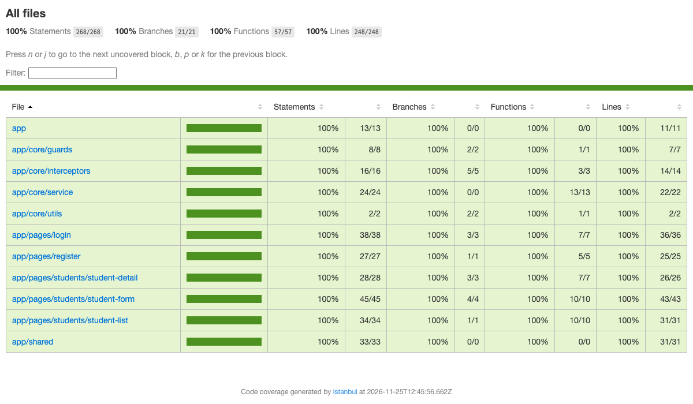
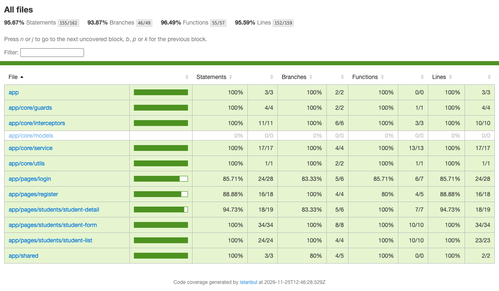

# EtudiantFrontend

Interface Angular d'EtuBibliothèque : inscription et connexion des agents, puis gestion des étudiants (liste, détail, ajout, modification, suppression), consommant l'API du [back-end](https://github.com/emousse/EtuBibliotheque-back).

This project was generated using [Angular CLI](https://github.com/angular/angular-cli) version 19.2.16.

## Development server

To start a local development server, run:

```bash
ng serve
```

Once the server is running, open your browser and navigate to `http://localhost:4200/`. The application will automatically reload whenever you modify any of the source files.

## Code scaffolding

Angular CLI includes powerful code scaffolding tools. To generate a new component, run:

```bash
ng generate component component-name
```

For a complete list of available schematics (such as `components`, `directives`, or `pipes`), run:

```bash
ng generate --help
```

## Building

To build the project run:

```bash
ng build
```

This will compile your project and store the build artifacts in the `dist/` directory. By default, the production build optimizes your application for performance and speed.

## Running unit tests

To execute unit and integration tests with the [Jest](https://jestjs.io/) test runner, use the following command:

```bash
npm test
```

The coverage report is generated in `coverage/index.html`. Jest fails if coverage drops below 80 %.

Current result: 52 tests, **100 % coverage**.



## Running end-to-end tests

End-to-end tests use [Cypress](https://www.cypress.io/). API calls are mocked with `cy.intercept()`, so the back-end does not need to run.

The Cypress binary is stored inside the project (`.cypress-cache/`, ignored by Git). After `npm install`, download it once with:

```bash
npm run cypress:install
```

Then:

```bash
npm run e2e            # starts an instrumented dev server on port 4210 and runs all specs headless
npm run e2e:open       # same, with the interactive Cypress UI
npm run e2e:coverage   # prints the E2E coverage summary and fails below 80 %
```

The E2E coverage report is generated in `coverage-e2e/index.html`. The instrumented build (`build-e2e` / `serve-e2e` targets, `coverage.webpack.js`) is only used for end-to-end tests; `ng serve` and `ng build` are unchanged.

Current result: 25 tests, **95.59 % of lines covered**.



## Additional Resources

For more information on using the Angular CLI, including detailed command references, visit the [Angular CLI Overview and Command Reference](https://angular.dev/tools/cli) page.
